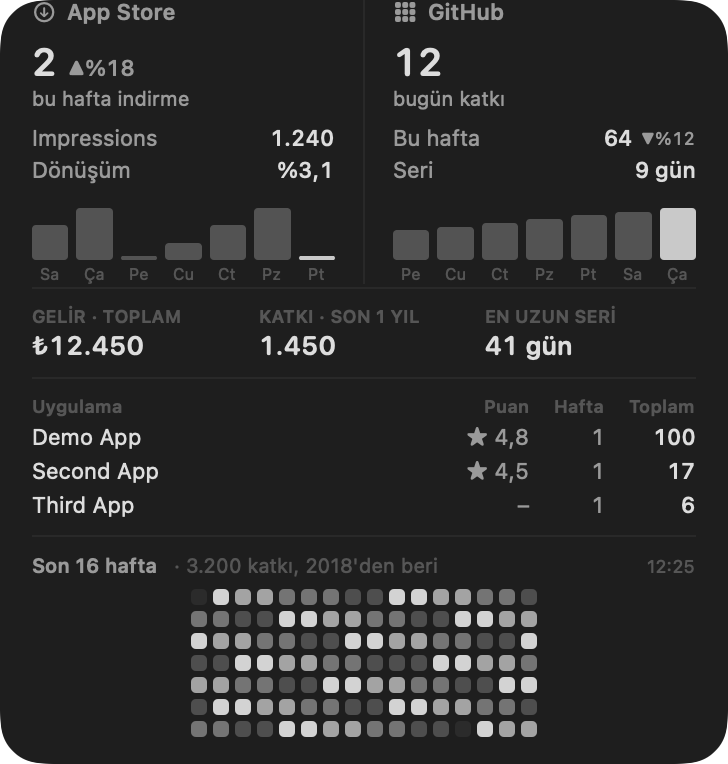
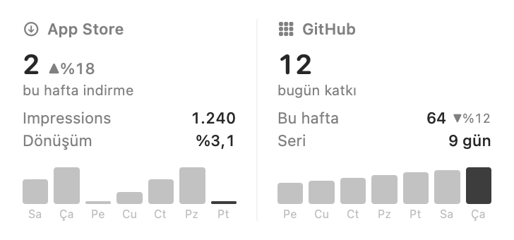
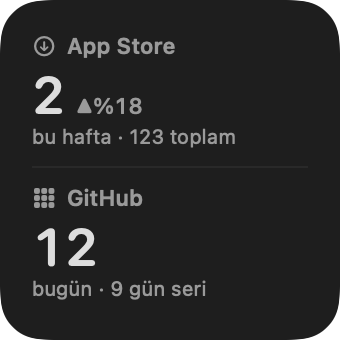

# Dev Stats

Your App Store and GitHub numbers in the macOS menu bar and on the desktop.

- **App Store:** new downloads (last report day, this week, all time) per app with a
  ▲▼ change against the same days of last week, redownloads, updates, in-app purchases,
  revenue in your currency, star ratings, top countries, the latest written reviews
  (with a notification when a new one arrives), impressions, product page views and
  conversion rate.
- **GitHub:** contributions today, this week (▲▼ vs last week), last year and all time
  (the numbers on your profile overview), current and longest streak, the repos you
  committed to most this week, a 7-day chart and a contribution heat grid.
- **Resilient:** if an API is down, the last good numbers stay on screen with the time
  they were fetched.

Everything runs locally. Data comes straight from Apple's App Store Connect API and
GitHub's GraphQL API. Nothing is sent anywhere else.





Previews use demo data.

## Install with Claude Code (copy-paste prompt)

Paste this into Claude Code (or any coding agent that has a terminal):

```text
Install Dev Stats from https://github.com/tolgazorlu/devstats on my Mac.

1. Look at what I already have before installing anything: Homebrew, Python 3,
   Xcode (xcodebuild), GitHub CLI (gh) and whether it is logged in, SwiftBar,
   xcodegen. Tell me what is missing and ask before installing it.
2. Clone the repo to ~/projects/devstats and read README.md fully.
3. Run scripts/install.sh. If Xcode is missing, run it with --no-widget.
4. Walk me through creating an App Store Connect API key (README section "App Store
   Connect key"). Ask me only for: Issuer ID, Key ID, Vendor Number and the path of
   the downloaded .p8 file, and which currency revenue should be shown in (e.g. TRY,
   USD, EUR). Then run scripts/configure.py with those values.
5. Security rules: never print, cat, copy into chat, or commit the .p8 file or
   ~/.config/asc-menubar/*. Never ask me to paste the key's contents.
6. If my key has the Admin role, run scripts/request_reports.py once, then tell me
   to create a "Sales and Reports" key, switch to it with configure.py and revoke
   the Admin key.
7. Run plugins/devstats.30m.sh once and show me the output, so we both see real
   numbers. Tell me the menu bar item and the widget are ready, and how to add the
   widget to the desktop.
```

## What you need

- macOS 14 or newer
- Python 3 (ships with the Xcode command line tools)
- [SwiftBar](https://swiftbar.app) for the menu bar (the installer adds it via Homebrew)
- [GitHub CLI](https://cli.github.com) logged in (`gh auth login`) for GitHub stats
- Xcode, only for the desktop widget. The menu bar part works without it.

## Install by hand

```sh
git clone https://github.com/tolgazorlu/devstats ~/projects/devstats
cd ~/projects/devstats
scripts/install.sh            # or: scripts/install.sh --no-widget
```

The installer is idempotent. It creates `.venv`, installs SwiftBar and xcodegen if
missing, points SwiftBar at `plugins/` (or links the plugin into your existing
SwiftBar folder), builds the widget app into `~/Applications/DevStats.app` and opens it.

## App Store Connect key

1. App Store Connect > **Users and Access** > **Integrations** > **App Store Connect
   API**. If you never used the API, the Account Holder clicks **Request Access** first.
2. **Team Keys** tab > **Generate API Key**. Individual keys cannot read sales reports.
   - Role **Sales and Reports** is enough for downloads and for reading impressions.
   - Impressions need a one-time "report request" that only an **Admin** key can
     create. Easiest path: create an Admin key first, run the setup below, then create
     a Sales and Reports key, switch to it and revoke the Admin key.
3. Download the `.p8` file (Apple lets you do this once).
4. Note the **Issuer ID** (top of the keys page), the **Key ID**, and your **Vendor
   Number** (Payments and Financial Reports, top left).

```sh
.venv/bin/python scripts/configure.py \
  --issuer-id 00000000-0000-0000-0000-000000000000 \
  --key-id ABC123DEFG \
  --vendor-number 12345678 \
  --p8 ~/Downloads/AuthKey_ABC123DEFG.p8 \
  --currency TRY

# once, with the Admin key, for impressions and conversion rate:
.venv/bin/python scripts/request_reports.py
```

`configure.py` moves the key into `~/.config/asc-menubar/` with `0600` permissions and
writes `config.json` next to it. To switch keys, run it again with the new values.

## Using it

**Menu bar:** one item showing App Store downloads this week and GitHub contributions
today. Click it for the tables. Hover an app for its details and a link to App Store
Connect, its rating per country, its top countries and its reviews. The plugin
refreshes every 30 minutes, **Yenile** refreshes now. New reviews arrive as a macOS
notification from SwiftBar (allow SwiftBar notifications in System Settings).

**Desktop widget:** right-click the desktop > **Edit Widgets** > search **Dev Stats**.
Three sizes: small (two headline numbers with change and streak), medium (both
columns with 7-day bars), large (adds revenue or rating, contributions last year,
longest streak, the top apps with their rating, and a 25-week contribution grid).
It shows "eski veri" when the plugin has not refreshed for over an hour. Monochrome, follows
light and dark mode. The widget reads the snapshot the menu bar plugin writes, so the
plugin has to be running.

## How the numbers work

| Number | Source | Notes |
| --- | --- | --- |
| Downloads (day / week) | Sales reports, daily | Apple publishes a day about a day later, in Pacific time. Week starts Monday. |
| Downloads (all time) | Sales reports, yearly + monthly + daily | Finished periods are cached forever, so later runs are fast. |
| Impressions, page views | Analytics Reports, "App Store Discovery and Engagement Standard" | First data arrives 1-2 days after `request_reports.py`. History back to 2024 via the one-time snapshot. |
| Conversion rate | (first-time downloads + redownloads) / unique impressions | Same definition as App Store Connect. Unique counts are summed over report rows, so treat it as an approximation. |
| ▲▼ change | same weekdays of the previous week | This week so far vs Monday up to the same weekday last week, so a Wednesday is not compared with a full week. |
| Revenue | Sales reports `Developer Proceeds` x units | Proceeds are after Apple's commission, in the payout currency, converted to your display currency with today's rate from [open.er-api.com](https://www.exchangerate-api.com). App Store Connect uses each month's rate, so all-time revenue is an approximation. |
| Ratings | public `itunes.apple.com/lookup`, no key | Ratings are per storefront; every storefront the app has downloads in is queried and combined, weighted by count. Cached 12 hours. |
| Reviews | `GET /v1/apps/{id}/customerReviews` | Written reviews only. The first run records existing ones silently; afterwards each new review notifies once. |
| GitHub contributions | GraphQL `contributionsCollection` | "Last year" matches the profile overview. Commit count covers public repos; private work shows up as private contributions. |
| Streaks | per-year contribution calendars since the account was created | Finished years are cached. Today without contributions does not break the streak until the day is over. |
| GitHub days | UTC | GitHub buckets contributions by UTC day and the API has no timezone option, so "today" flips at 03:00 in Türkiye. |

Apple hides rows with very small counts in analytics reports for privacy, so
impressions for a tiny app can read lower than reality.

## Where things live

```
~/.config/asc-menubar/         # outside the repo, never committed
  config.json                  # issuer id, key id, vendor number (0600)
  AuthKey_<KEYID>.p8           # private key (0600)
  cache/                       # downloaded reports
  snapshot.json                # latest numbers, read by the widget
```

| Path | What |
| --- | --- |
| `asc.py` | App Store Connect client (JWT, paging, report download) |
| `appstore.py` | Downloads, revenue, countries and weekly change from Sales reports |
| `fx.py` | Exchange rates for revenue (cached daily) |
| `analytics.py` | Impressions, page views, conversion from Analytics reports |
| `ratings.py` | Star ratings per storefront |
| `reviews.py` | Latest written reviews, new-review detection |
| `github.py` | GitHub contributions, streaks, top repos, rate limit |
| `tests/` | Behavior tests with fixtures, no network |
| `devstats.py` | Menu bar output + snapshot for the widget |
| `plugins/devstats.30m.sh` | SwiftBar entry point (refresh interval is in the file name) |
| `widget/` | SwiftUI app + WidgetKit extension (generated with xcodegen) |
| `scripts/` | install, configure, request_reports |

The widget is sandboxed and only has read access to `~/.config/asc-menubar/`.

## Troubleshooting

- **Menu shows `!`:** open the menu, the error is printed under the section that failed.
  Run `plugins/devstats.30m.sh` in a terminal to see the full output.
- **HTTP 401:** wrong Issuer ID or Key ID, or the key was revoked.
- **HTTP 403 on `request_reports.py`:** the key is not Admin.
- **Impressions say "hazırlanıyor":** Apple has not published the first analytics
  instance yet. Wait 1-2 days after `request_reports.py`.
- **Widget says "Veri yok":** the plugin has not written a snapshot yet. Click Yenile.
- **"Yorumlar: HTTP 403":** the API key's role cannot read customer reviews. Everything
  else keeps working; use a key with a role that has access to reviews if you want them.
- **No notification for a new review:** System Settings > Notifications > SwiftBar >
  allow.
- **Widget not in the gallery:** open `~/Applications/DevStats.app` once, then check
  `pluginkit -m | grep devstats`.

## Development

```sh
.venv/bin/python -m unittest discover -s tests   # data layer, no network
plugins/devstats.30m.sh                          # real run, prints the menu
widget/build/Build/Products/Release/DevStats.app/Contents/MacOS/DevStats --render --sample
                                                 # PNG previews of every widget size
```

## Uninstall

```sh
rm -rf ~/Applications/DevStats.app ~/.config/asc-menubar
defaults delete com.ameba.SwiftBar PluginDirectory   # if it pointed here
```

Then revoke the API key in App Store Connect.
